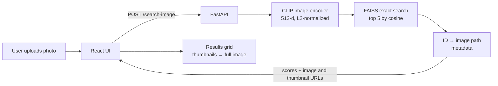
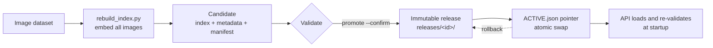

# 🔍 Image Similarity Search

A full-stack **content-based image retrieval** system. Upload a photo and it
returns the most visually similar images from a collection, ranked by
similarity. It uses **CLIP** image embeddings, a **FAISS** vector index, a
**FastAPI** backend and a **React** frontend.

Beyond the core search, the project focuses on making an ML service reliable:
reproducible index builds, versioned releases with rollback, a pinned model
version, hardening for public demos, and measured retrieval quality on a
public benchmark.

**Highlights**

- **mAP 0.844** on the INRIA Holidays retrieval benchmark (500 queries), against
  0.746 for INRIA's own 2008 system under the same official scorer.
- **~270 ms** median search latency on a laptop CPU. FAISS search itself takes
  under 2 ms.
- **196 automated tests**: 184 backend and 12 frontend.

---

## 🧰 Tech Stack

| Layer | Technology |
|---|---|
| Embeddings | [CLIP](https://openai.com/research/clip) ViT-B/32 (`openai/clip-vit-base-patch32`) via Hugging Face Transformers and PyTorch |
| Vector search | FAISS (`IndexFlatIP` over L2-normalized vectors = exact cosine similarity) |
| Backend | Python 3.10, FastAPI, Uvicorn, Pillow, NumPy |
| Frontend | React (Create React App) |
| Testing | pytest, FastAPI TestClient, Jest and React Testing Library |
| Deployment | Single-origin FastAPI serving the React build; Nginx and systemd templates; Cloudflare Tunnel for demos |

---

## 🧠 How It Works



**Offline indexing and releases.** The index is built and shipped like a
software release, not edited in place:



---

## ✨ Features

- **Image-to-image search** with similarity scores, served through a REST API
  and a responsive web UI that works on mobile.
- **One embedding service** shared by indexing and search, so both use the same
  model, preprocessing and normalization.
- **Reproducible index builds**:
  - Deterministic full rebuilds.
  - Stable image IDs (a SHA-256 of the dataset-relative path).
  - A dataset content fingerprint.
  - A manifest recording the model, preprocessing, metric and checksums.
- **Versioned releases**:
  - Validated candidates become immutable releases, identified by the content
    and provenance hashes.
  - Activation and rollback are an atomic pointer swap under a file lock.
  - Both are dry runs by default.
- **Fail-closed startup.** The API re-validates the active release and checks
  that it was built with the **same pinned CLIP model revision**. If anything
  doesn't match, it refuses to serve (`/ready` returns 503) instead of returning
  wrong results.
- **Public-demo hardening**:
  - A streaming upload size limit (413) and body-read timeout (408).
  - A concurrency cap (429 with `Retry-After`) and per-query timeout (504).
  - CPU inference runs off the async event loop.
  - Path-traversal- and symlink-safe file serving.
  - No host paths or stack traces in responses, and API docs off by default.
- **Fast results on mobile.** The results grid uses cached, downscaled JPEG
  thumbnails, about 400× smaller than camera-resolution originals, and links
  each one to the full image.
- **Measured quality.** There's an evaluation harness for Precision@K,
  Recall@K, mAP and MRR, plus reproducible benchmark tooling for INRIA Holidays.

---

## 📏 Benchmark Results

Retrieval quality was measured on **INRIA Holidays** (Jégou, Douze & Schmid,
ECCV 2008): 1,491 holiday photos in 500 groups, each showing the same scene or
object from different viewpoints. The first photo of each group is the query,
and the rest of the group are the correct matches.

| Metric (500 queries, gallery of 1,491) | Result |
|---|---|
| **mAP, official INRIA scorer** | **0.844** |
| mAP, standard (non-interpolated) AP | 0.863 |
| Top-1 result correct | 85.6% |
| Recall@10 | 0.940 |
| MRR | 0.898 |
| *Reference: INRIA's 2008 systems, same scorer* | *0.446 / 0.746* |

| Per-query latency (CPU, after warm-up) | p50 | p95 |
|---|---|---|
| JPEG decode | 61 ms | 135 ms |
| CLIP embedding | 208 ms | 279 ms |
| FAISS exact search (full ranking) | 1.7 ms | 2.0 ms |
| **Total** | **270 ms** | **408 ms** |

- **Setup:** pretrained CLIP ViT-B/32 at a pinned revision, no fine-tuning,
  exact search, CPU only.
- **Indexing cost:** 1,491 photos took 6.5 minutes (about 7.4 images/s for
  CLIP inference) with 2.6 GB peak memory.
- **Takeaway:** CLIP accounts for about 75% of query time, while exact FAISS
  search is negligible at this scale. That's why the project keeps exact search
  instead of an approximate index.
- **Scope:** this is a single run on one machine. The two mAP values differ
  only in how average precision is computed: the official scorer uses
  trapezoidal interpolation.

---

## 🧩 Design Decisions

| Decision | Why |
|---|---|
| **Pretrained CLIP, no fine-tuning** | Strong general-purpose visual embeddings with no labelled training data. The benchmark shows it beats classic local-feature retrieval out of the box. |
| **Exact search (`IndexFlatIP`)** | With normalized vectors, inner product equals cosine similarity. At thousands of images, exact search costs about 2 ms, so approximate indexes (HNSW, IVF) would add recall loss for no real speed gain. |
| **Pinned model revision** | Embeddings are only comparable if they come from the same model. If the upstream model changed silently, queries would no longer match the index, so the API refuses releases built with a different revision. |
| **Immutable releases and an atomic pointer** | An index can be promoted, audited and rolled back like a software release. A failed build can never half-replace the live index. |
| **Stable path-hash IDs** | The same image keeps the same ID across rebuilds, and no machine-specific absolute paths are stored. |
| **Fail closed, with liveness separate from readiness** | `/health` reports that the process is alive; `/ready` is 200 only when a validated release is loaded. Bad data produces a clear 503 instead of wrong answers. |
| **Single origin** | FastAPI serves the React build, the API and the images from one origin. That means no CORS setup, and one URL to share through a tunnel. |

---

## 🔌 API

| Endpoint | Description |
|---|---|
| `POST /search-image` | Multipart upload (field `file`). Returns the top 5 matches. |
| `GET /health` | Liveness and runtime info (mode, active release, vector count). |
| `GET /ready` | 200 only when a validated release is loaded, otherwise 503. |
| `GET /images/<path>` | Full-size image. |
| `GET /thumbnails/<path>` | Cached JPEG preview, 384 px on the longest side by default. |

```json
{
  "results": [
    {
      "id": 7488443327725773495,
      "score": 0.8189,
      "path": "_RSB8646.JPG",
      "image_url": "/images/_RSB8646.JPG",
      "thumbnail_url": "/thumbnails/_RSB8646.JPG"
    }
  ]
}
```

Errors: `400` invalid image, `408` upload stalled, `413` upload too large,
`429` busy, `503` not ready, `504` timed out.

---

## 🚀 Getting Started

**Requirements:** Python 3.10 and Node.js. The CLIP model (about 600 MB) is
downloaded on first use.

```bash
# 1. Install
python3.10 -m venv .venv && source .venv/bin/activate
pip install -r backend/requirements-dev.txt
(cd frontend && npm install)

# 2. Add images to dataset/, then build, check and activate an index
cd backend
python rebuild_index.py --dataset ../dataset --output-dir candidate_index
python promote_release.py candidate_index --dataset ../dataset            # dry run
python promote_release.py candidate_index --dataset ../dataset --confirm  # activate

# 3. Build the UI and serve everything from one origin
(cd ../frontend && REACT_APP_API_BASE_URL= npm run build)
IMGSIMI_FRONTEND_DIR=../frontend/build python -m uvicorn main:app --host 127.0.0.1 --port 8080
```

Open http://127.0.0.1:8080. For development with hot reload, run
`uvicorn main:app --reload --port 8000` from `backend/` and `npm start` from
`frontend/`. The React dev server proxies API calls to port 8000.

Runtime behaviour is configured with `IMGSIMI_*` environment variables, for
example the upload limit, concurrency, timeouts, thumbnail size and model
warm-up. `deploy/` contains a launcher script and Nginx and systemd templates.

**Running the tests:**

```bash
cd backend && python -m pytest -q                      # 184 tests, some load the real CLIP model
cd frontend && CI=true npm test -- --watchAll=false    # 12 tests
```

**Reproducing the benchmark:** download INRIA Holidays from the
[official page](https://lear.inrialpes.fr/~jegou/data.php.html), then:

```bash
python evaluation/holidays_to_jsonl.py --perfect-result <holidays>/eval_holidays/perfect_result.dat \
  --images-dir <holidays>/jpg --output <holidays>/ground_truth.jsonl
cd backend
python rebuild_index.py --dataset <holidays>/jpg --output-dir <holidays>/candidate_index
python evaluate_retrieval.py --candidate-dir <holidays>/candidate_index --dataset <holidays>/jpg \
  --ground-truth <holidays>/ground_truth.jsonl --ks 1,5,10,1490
```

`evaluation/holidays_benchmark.py` measures latency and writes rankings that
INRIA's official scorer can read.

---

## 📁 Project Structure

```
ImgSimiSearch/
├── backend/
│   ├── main.py                  # FastAPI app: search, health/readiness, images, thumbnails
│   ├── embeddings.py            # Shared CLIP service (pinned revision)
│   ├── faiss_index.py           # FAISS index helpers
│   ├── rebuild_index.py         # Deterministic candidate build and validation
│   ├── promote_release.py       # Activate a candidate as an immutable release
│   ├── rollback_release.py      # List releases and roll back
│   ├── release_store.py         # Release storage, atomic activation, locking
│   ├── artifact_manifest.py     # Build provenance manifest
│   ├── artifact_validation.py   # Index, metadata and manifest consistency checks
│   ├── artifact_paths.py        # Safe dataset path resolution and URL encoding
│   ├── stable_ids.py            # Path-hash image IDs
│   ├── dataset_fingerprint.py   # Dataset content fingerprint
│   ├── thumbnails.py            # Cached JPEG previews
│   ├── request_limits.py        # Upload size and timeout middleware
│   ├── evaluate_retrieval.py    # Precision/Recall/mAP/MRR evaluation
│   ├── retrieval_metrics.py     # Metric definitions
│   └── tests/                   # 184 backend tests
├── frontend/src/                # React UI: App.js, api.js, components/SearchBox.jsx
├── evaluation/                  # INRIA Holidays tools and ground-truth schema
└── deploy/                      # Demo launcher, Nginx and systemd templates
```

---

## ⚠️ Limitations and Roadmap

- **Not yet:** a containerized build (Docker) and continuous integration.
- **Orientation:** photo orientation (EXIF) is not applied before embedding,
  so some rotated images may score lower.
- **Not for open public use yet:** there's no authentication or per-client
  rate limiting.
- **Next steps:**
  - GPU inference.
  - Text-to-image search (CLIP is multimodal).
  - An approximate index once the collection is large enough to need one.

---

## 📝 License

The source code is released under the [MIT License](LICENSE). Image datasets
are not part of this repository. INRIA Holidays images are copyright INRIA
and are used only for evaluation.
